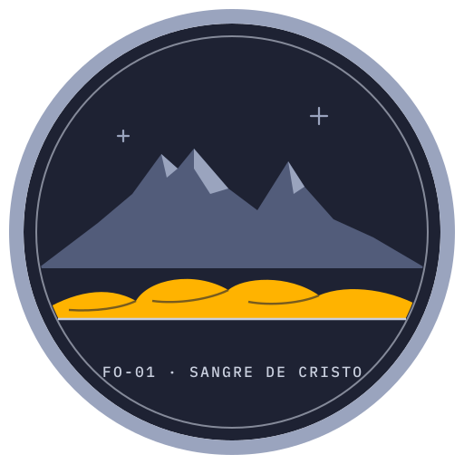
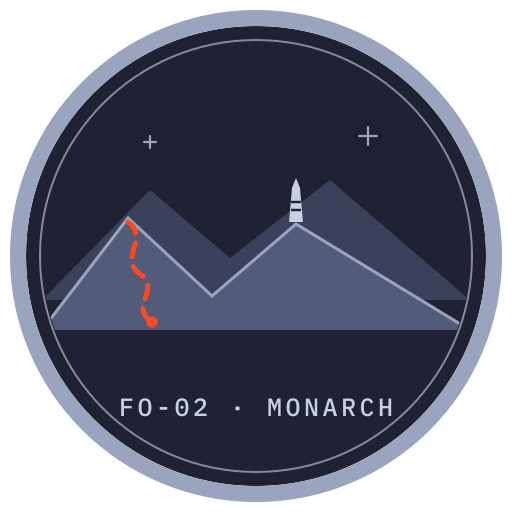
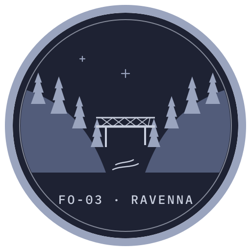
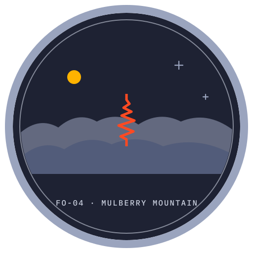
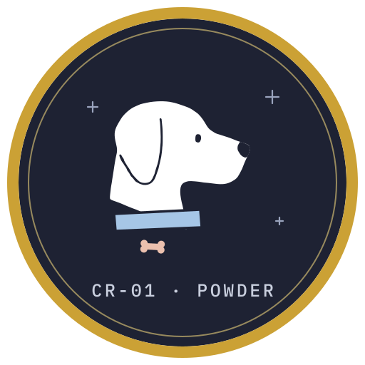

<div align="center">


# nykolas.me

**The personal site of Nykolas Farhangi**

[**nykolas.me**](https://nykolas.me) &nbsp;·&nbsp; [**Flight Manual**](https://nykolas.me/flight-manual)

<sub>The Flight Manual holds the NYKO design package and notes: tokens, principles, survey data and credits.</sub>

<br />







</div>

---

## Pre-flight

Requires Node 22 (see `.nvmrc`).

```sh
npm install
```

## Launch

```sh
npm run dev        # local dev server at http://localhost:4321
npm run build      # static build to dist/
npm run preview    # serve the built site
```

To include the archived sites at `/v1` and `/v2`, run `npm run build:archive` after `npm run build`.

Pushes to `main` build and deploy to GitHub Pages automatically. Changes only under `archive/` do not trigger a deploy.

## Manifest

```
.
├── src/            site source (Astro): pages, components, styles, copy in src/data/site.ts
├── public/         static assets: brand marks, patches, favicons
├── brand/          NYKO identity source files and generators
├── scripts/        token, terrain and budget build scripts
├── data/           raw elevation data for the FO-01 survey sheet
└── archive/        earlier versions of nykolas.me, with full git history
    ├── v1/         the original static site          → nykolas.me/v1
    └── v2/         the second site (nykolas.me-21)   → nykolas.me/v2
        ├── app/    React app         (was crudemandarin/nykolas.me-21)
        └── api/    Express API       (was crudemandarin/nykolas.me-21-backend)
```
